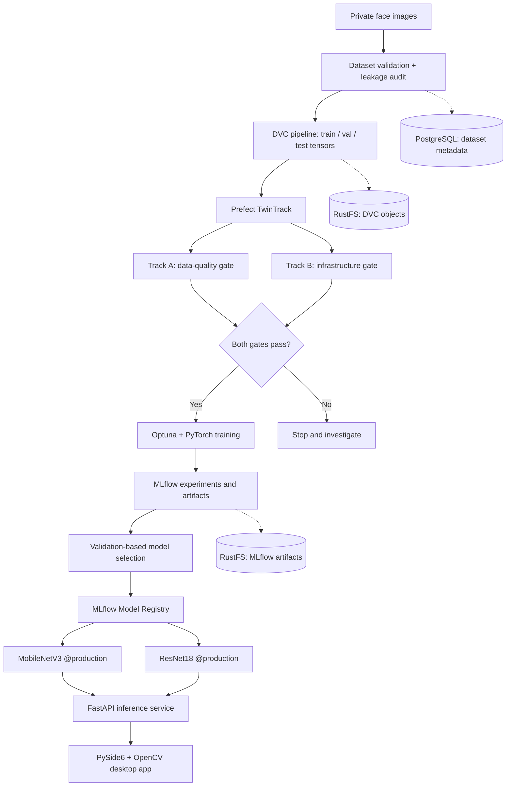

# FaceOps TwinTrack

**End-to-End MLOps Pipeline for Real-Time Face Classification**

[](https://www.python.org/)
[](https://pytorch.org/)
[](https://mlflow.org/)
[](https://www.prefect.io/)
[](https://dvc.org/)

> **ML2 Lab 2 · HND in Data Science**
>
> **Group:** COHNDDS252F-002 · COHNDDS252F-003 · COHNDDS252F-004  
> **Project status:** Functional local MLOps prototype, including two registered and served models and a desktop webcam client.

## Overview

**FaceOps TwinTrack** is an end-to-end, locally hosted MLOps system built around the *Find My Friend* four-class image-classification task. It manages the complete workflow from dataset validation and versioning through model tuning, experiment tracking, controlled promotion, API serving, and real-time desktop inference.

The project's distinctive feature is **TwinTrack orchestration**: a Prefect workflow runs separate **data-quality** and **infrastructure-readiness** checks, then allows model training only after both gates succeed.

This is a consent-based classroom prototype, **not** a biometric identity-verification or access-control system.

## Key Features

- **Dataset engineering:** Image validation, metadata manifests, PyTorch tensor creation, and leakage/capture-session audits.
- **Version control:** Git for source code and DVC with RustFS for private image and tensor artifacts.
- **Metadata database:** PostgreSQL for class information, image records, and dataset versions.
- **Model training:** Custom CNN, MobileNetV3-Small, and ResNet18 using PyTorch.
- **Hyperparameter optimization:** Resumable Optuna studies; epoch-level training/validation metrics and plots tracked in MLflow.
- **Unique orchestration:** Prefect TwinTrack with data-quality and infrastructure gates.
- **Model management:** Three models registered in MLflow; two given `@production` aliases.
- **Serving:** FastAPI endpoints for each production model and side-by-side comparison.
- **Desktop client:** PySide6 and OpenCV webcam interface with live face detection and dual-model predictions.
- **CI/CD:** GitHub Actions source/configuration checks and a manually triggered container-image release workflow.

## Architecture



**Orchestration and CI/CD are distinct:** Prefect manages the local data/training process; GitHub Actions validates source changes and supports controlled release of the serving image.

## Dataset

Four classes: **Pawara, Uchitha, Dhamith, Unknown**.

| Class | Train | Validation | Test | Total |
|---|---:|---:|---:|---:|
| Pawara | 35 | 8 | 7 | 50 |
| Uchitha | 34 | 7 | 8 | 49 |
| Dhamith | 34 | 7 | 8 | 49 |
| Unknown | 41 | 10 | 10 | 61 |
| **Total** | **144** | **32** | **33** | **209** |

The final tensor images are **224 × 224 RGB**, stored in `train.pt`, `val.pt`, and `test.pt` (dataset version **2**).

**Evaluation limitation:** Each of the three named people was photographed in only one capture session. Even though the final split uses chronological segments for those classes and intact capture groups for Unknown, the test set is **not independent-session evidence**. Results can be optimistic under new lighting, poses, backgrounds, or cameras. Raw face photographs and tensors are deliberately excluded from Git.

## Model Performance

All three architectures underwent Optuna tuning (three trials per model; up to eight epochs per trial). The model shortlist was frozen using **validation loss only**, before one held-out evaluation.

| Model | Best validation loss | Test accuracy | Test macro-F1 | Registry status |
|---|---:|---:|---:|---|
| **MobileNetV3-Small** | **0.0259** | **93.94%** | **0.9377** | v1 · `@production` |
| **ResNet18** | 0.7466 | 87.88% | 0.8710 | v1 · `@production` |
| Custom CNN | 0.7618 | 60.61% | 0.4778 | v1 · registered |

These scores come from **33 held-out test photographs** and should be interpreted in the context of the capture-session limitation above. Softmax confidence is uncalibrated, and the `Unknown` class is not a validated stranger-rejection mechanism.

Complete training and validation loss curves, detailed metrics, and run histories are stored in the private MLflow experiment artifacts and documented in the accompanying lab report.

## Technology Stack

| Layer | Technology |
|---|---|
| Deep learning | Python, PyTorch, TorchVision |
| Hyperparameter optimization | Optuna |
| Experiment tracking and model registry | MLflow |
| Pipeline orchestration | Prefect 3 |
| Dataset versioning | DVC + Git |
| Object storage | RustFS (S3-compatible) |
| Metadata and workflow databases | PostgreSQL |
| API inference | FastAPI + Uvicorn |
| Desktop inference | PySide6 + OpenCV |
| Containers and automation | Docker Compose, Bash, GitHub Actions |

## Repository Layout

```text
find-my-friend-mlops/
├── .github/workflows/      # CI and manually triggered release
├── desktop/                # PySide6 interface and webcam client
├── docker/                 # MLflow/serving Dockerfiles, SQL initialization
├── orchestration/          # FaceOps TwinTrack Prefect flow
├── scripts/                # Setup, checks, training, startup, deployment
├── src/
│   ├── data/               # Validation, audits, tensors, DataLoader
│   ├── database/           # PostgreSQL metadata import
│   ├── evaluation/         # Held-out evaluation
│   ├── models/             # Three PyTorch architectures
│   ├── registry/           # MLflow registration and model aliases
│   ├── serving/            # FastAPI and model loading
│   ├── storage/            # RustFS artifact access
│   └── training/           # Training engine and Optuna
├── tests/                  # Model, loader, training and client tests
├── compose.yaml
├── compose.prefect.yaml
├── compose.serving.yaml
├── dvc.yaml
├── dvc.lock
└── requirements-desktop.txt
```

*Private image data, tensors, credentials, local optimization databases, and evaluation reports are not distributed with the Git repository.*

## Running Locally (Ubuntu)

**Prerequisites:** Python 3.12, a project `.venv` with the required dependencies, Docker and Docker Compose, the configured private `.env`, access to the private DVC/RustFS data, and the previously initialized PostgreSQL/MLflow/Prefect services. **A fresh clone alone will not reproduce trained models**, because datasets and model artifacts are stored privately.

### 1. Start the infrastructure

```bash
cd ~/Desktop/find-my-friend-mlops
source .venv/bin/activate

sudo docker compose up -d rustfs postgres mlflow
sudo docker compose -f compose.yaml -f compose.prefect.yaml up -d prefect
```

Service interfaces on the Ubuntu machine:

- **MLflow:** http://127.0.0.1:5050
- **Prefect:** http://127.0.0.1:4200
- **RustFS Console:** http://127.0.0.1:9001

### 2. Validate the pipeline

```bash
dvc status
dvc repro
bash scripts/run_training.sh preflight
```

### 3. Run an Optuna tuning study (optional)

```bash
bash scripts/run_training.sh tune 3 8
```

This adds **three trials per model**, each with at most **eight epochs**; rerunning the command adds more trials to the resumable studies. The held-out test split is not used for tuning.

### 4. Start the approved inference API

```bash
bash scripts/start_serving.sh
```

In another terminal:

```bash
source .venv/bin/activate
python scripts/test_serving.py
```

API documentation: **http://127.0.0.1:8000/docs**

| Method | Route | Purpose |
|---|---|---|
| GET | `/health` | API and model-loading health |
| GET | `/models` | Active registered models |
| POST | `/predict/model-a` | MobileNetV3 inference |
| POST | `/predict/model-b` | ResNet18 inference |
| POST | `/predict/compare` | Side-by-side model inference |

Image requests use multipart upload field `image` with a cropped JPEG, PNG or WebP face image.

### 5. Launch the desktop application

Keep FastAPI running, then use a second terminal:

```bash
source .venv/bin/activate
python -m pip install -r requirements-desktop.txt
bash scripts/start_desktop.sh
```

Use **Start Camera** to enable the webcam. The application detects and crops a face, calls the comparison API, and displays both model outputs. It does not intentionally save webcam frames.

### Optional: Docker-based API deployment

Stop the native FastAPI process on port 8000 first, then run:

```bash
bash scripts/deploy_local.sh
```

This builds/starts the serving container, checks API health, and verifies that two production models are loaded. Docker volumes are retained.

## Continuous Integration & Delivery

- **CI:** `.github/workflows/ci.yml` runs on pushes, pull requests, or manual dispatch. It checks source syntax, Compose configuration, synthetic model contracts, mocked desktop-client behaviour, and tracked-file privacy rules.
- **Delivery:** `.github/workflows/release.yml` is manually triggered to build and publish the serving image to GitHub Container Registry.
- **Deployment:** The image is deployed to the local Ubuntu environment only through an operator-controlled process—not automatically from GitHub.

GitHub-hosted CI does **not** access the private face dataset or perform full training. Confirm the actual CI run status in the repository's **Actions** tab.

## Responsible Use & Limitations

This prototype is designed for **consent-based academic demonstration**. It must **not** be used for authentication, access control, disciplinary attendance tracking, or high-stakes identification. Accuracy has not been established for independent capture sessions, and `Unknown`/confidence scores are not robust open-set identification guarantees.

## Project Documentation

The ML2 Lab 2 PDF report includes Optuna training analysis, **all three selected-run training/validation loss curves**, held-out results, limitations, TwinTrack diagrams, and CI/CD architecture. The report can be submitted separately with the coursework package without publishing private training artifacts.

---

**Project:** FaceOps TwinTrack · **Module:** Machine Learning II (ML2 Lab 2)  
**Group:** `COHNDDS252F-002` · `COHNDDS252F-003` · `COHNDDS252F-004`
